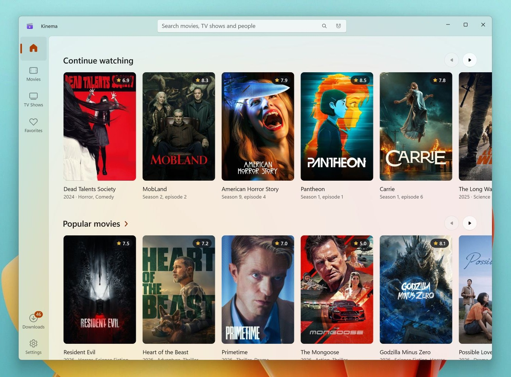

# Kinema — Movie & TV Show App for Windows

**Kinema** is a free movie and TV show app for Windows 10 and 11: a Microsoft Store–style catalog of films, series, anime and cartoons with online playback, torrent streaming and a built-in player.

One portable `.exe`: no installer, no account, no ads. Updates itself.

## Features

- **Catalog** — trending and new movies, TV shows, anime and cartoons; filters, collections, instant search with people
- **Title pages** — trailers, ratings, cast, seasons and episodes, similar titles; actor and director filmographies
- **Watch** — online sources with a choice of voice-over and quality, or torrents streamed while they download
- **Continue watching**, favorites and history; notifications when a new episode or movie comes out
- **Player** — HDR with automatic display switching, chapters with intro and credits, black bar removal, volume normalization, sleep timer, picture-in-picture, auto-play of the next episode
- **Smooth motion** — frame interpolation up to your display's refresh rate (key **I**), or via Lossless Scaling
- **Cast to TV** — Chromecast, Android TV, Google TV and DLNA
- **Offline downloads**
- **Any network** — proxy, DNS-over-HTTPS and automatic mirrors
- Catalog in about 80 languages; interface in English, Russian, Ukrainian, German, French and Spanish

## Install

1. Download **[Kinema.exe](https://github.com/kinema-app/kinema/releases/latest/download/Kinema.exe)**.
2. Run it.

If SmartScreen says "Windows protected your PC", click **More info** → **Run anyway**.

**Requirements:** Windows 10 2004 or later, or Windows 11, x64.

Your data stays in `%LOCALAPPDATA%\Kinema`.

## Disclaimer

Kinema does not host or distribute any video content. It shows publicly available metadata and plays media from sources you choose. You are responsible for complying with the copyright laws of your country.

Metadata and images are provided by [The Movie Database (TMDB)](https://www.themoviedb.org/). This product uses the TMDB API but is not endorsed or certified by TMDB.

Built with WinUI 3, .NET, LibVLC, TorrServer, VapourSynth and other open-source components; licenses are in **Settings → About → Third-party components**.
